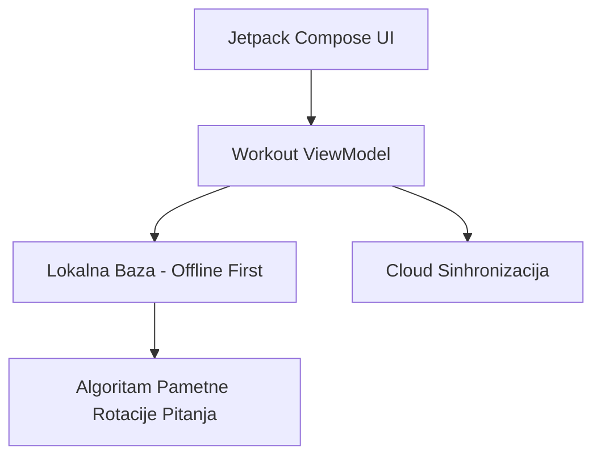

# 🧠 Mozaik Mozgalica - Kognitivni Trening za Starije i Penzionere (Android Native)

**Mozaik Mozgalica** je mobilna Android nativna aplikacija u **Kotlinu (Jetpack Compose)** napravljena sa ciljem da penzionerima i starijim osobama pruži svakodnevni, zabavan i **naučno dokazan trening kognitivnih sposobnosti, pamćenja i pažnje** – u duhu omiljenih srpskih TV kvizova (*TV Slagalica, Moj Broj, Asocijacije, Spojnice, Ko Zna Zna, Koliko Znaš Srbiju?*).

---

## 🔬 Naučni Dokazi i Psihološke Preporuke (Evidence-Based Design)

Dizajn ove aplikacije nije nasumičan – sve igre i pravila su direktno usklađeni sa **kliničkim studijama neurogerijatrije, kognitivne psihologije i gerontologije**:

### 1. ACTIVE Studija (JAMA - Journal of the American Medical Association)
* **Izvor**: *JAMA / National Institutes of Health (NIH)* – najobimnija klinička studija kognitivnog treninga u istoriji (2.802 seniora praćena 10 godina).
* **Nalaz**: Svakodnevni ciljani treninzi brzine obrade, rezonovanja i memorije odlažu kognitivni pad i održavaju samostalnost starijih i do **10 godina duže** u odnosu na kontrolnu grupu.
* **Primena u aplikaciji**:
  * *Brzina vizuelnog pretraživanja*: **Spojnice** (povezivanje parova).
  * *Induktivno rezonovanje*: **Asocijacije** (povezivanje pojmova u celinu).
  * *Verbalna radna memorija*: **TV Slagalica** (pretraživanje leksikona od 12 slova).

### 2. Hipoteza o "Kognitivnoj Rezervi" (Dr. Yaakov Stern, Columbia University)
* **Nalaz**: Mentalni izazovi podstiču **sinaptogenezu** (stvaranje novih veza između neurona). Što je kognitivna rezerva jača, to je mozak otporniji na demenciju i demencijalne promene.
* **Primena u aplikaciji**: Generisanje nasumičnih matematičkih ciljeva u igri **Moj Broj** tera mozak da stalno pravi nove računske putanje.

### 3. Terapija Reminiscencije (Reminiscence Therapy)
* **Nalaz**: Psihološke studije potvrđuju da je osvežavanje sećanja na istoriju, kulturu i detinjstvo ključno za emocionalno zdravlje i samopouzdanje u trećem dobu.
* **Primena u aplikaciji**: Igre **Koliko Znaš Srbiju? 🇷🇸** i **Ko Zna Zna** pobuđuju dugoročnu semantičku memoriju o manastirima, pesmama, geografiji i srpskoj baštini.

### 4. Smanjenje Performansne Anksioznosti (Gerontološka Psihologija)
* **Nalaz**: Starije osobe brzo odustaju ako ih aplikacija kažnjava gubljenjem poena ili strogim tajmerima, jer to izaziva stres i lučenje kortizola.
* **Primena u aplikaciji**: Uvedena su dugmad **"Pomoć"** (koja daje polovinu poena 5b umesto 0) i **"Odustajem"** (koje pokazuje odgovore bez kazne). Nema neuspeha – samo napretka!

---

## 📋 Sadržaj
1. [Naučni Dokazi i Psihološke Preporuke](#-naučni-dokazi-i-psihološke-preporuke-evidence-based-design)
2. [Sistem Igara (6 Omiljenih TV Kvizova)](#-sistem-igara-6-omiljenih-tv-kvizova)
3. [Dnevna Rutina (Jutarnji & Večernji Trening)](#-dnevna-rutina-jutarnji--večernji-trening)
4. [Prilagođavanje za Starije (Senior UI/UX & Pristupačnost)](#-prilagođavanje-za-starije-senior-uiux--pristupačnost)
5. [Strategija Monetizacije (Senior-Friendly Freemium)](#-strategija-monetizacije-senior-friendly-freemium)
6. [Kompletan Tehnološki Stak (Tech Stack)](#-kompletan-tehnološki-stak-tech-stack)
7. [Arhitektura & Upravljanje Bazom Pitanja (Hibridni Model)](#-arhitektura--upravljanje-bazom-pitanja-hibridni-model)
8. [Mapa Razvoja (Roadmap)](#-mapa-razvoja-roadmap)

---

## 🎮 Sistem Igara (6 Omiljenih TV Kvizova)

Aplikacija sadrži **6 ravnopravnih igara**:

1. **🔤 TV Slagalica (Reč Dana)**
   * **Opis**: Korisnik od 12 nasumičnih slova sastavlja najdužu reč u srpskom jeziku.
   * **Kognitivni cilj**: Verbalna tečnost i pretraživanje mentalnog leksikona.
   * **Poeni**: 3 poena po svakom iskorišćenom slovu.

2. **🔢 Moj Broj**
   * **Opis**: Kombinovanjem 6 ponuđenih brojeva i osnovnih računskih operacija (`+`, `-`, `*`, `/`) stiže se do zadatog trocifrenog ciljnog broja.
   * **Kognitivni cilj**: Radna memorija i računska kognicija.
   * **Poeni**: 30b za tačan broj, 20b/10b za male razlike.

3. **🧩 Asocijacije**
   * **Opis**: Tabla sa 4 kolone (A, B, C, D) i konačnim rešenjem.
   * **Etičko pravilo "Pomoć"**: Ako se igrač zaglavi, dugme **"Pomoć"** otkrva rešenje kolone i dodeljuje **5 poena** (polovina od 10b). Dugme **"Odustajem"** otkriva celokupnu tablu i omogućava nastavak bez osećaja poraza.

4. **🔗 Spojnice (Poveži Parove)**
   * **Opis**: Igra u 2 runde sa ukupno ~10 parova (pisci-dela, reke-slivovi, poslovice).
   * **Dizajn**: Klikom na pojam s leve i tačan par s desne strane, **oba pojma bivaju zelenom bojom i štriklirana (`✓`)**, što daje jasnu vizuelnu potvrdu.

5. **💡 Ko Zna Zna (Opšta Kultura)**
   * **Opis**: Kviz od **10 pitanja** iz opšte kulture, filma, nostalgije i muzike.
   * **Karakteristika**: Svako pitanje prati poučna poruka *"Da li ste znali?"* sa zanimljivim činjenicama.

6. **🇷🇸 Koliko Znaš Srbiju?**
   * **Opis**: Specijalizovani kviz posvećen srpskim manastirima (*Mileševa, Studenica, Žiča*), rekama, planinama, istorijskim ličnostima i kulturnoj baštini.

---

## ☀️🌙 Dnevna Rutina (Jutarnji & Večernji Trening)

Umesto beskonačnog i zamornog skrolovanja, aplikacija je strukturirana oko **2 Besplatna Dnevna Treninga**:

* **☀️ Jutarnji Trening**: 1x Slagalica + 1x Moj Broj + 1x Ko Zna Zna (10 pitanja). Idealno uz jutarnju kafu.
* **🌙 Večernji Trening**: 1x Asocijacije + 2x Spojnice + 1x Koliko Znaš Srbiju?. Idealno za opuštanje pred spavanje.

Ova struktura održava **dnevni niz (Streak)** i motiviše korisnika da svakodnevno vežba um.

---

## 👁️ Prilagođavanje za Starije (Senior UI/UX & Pristupačnost)

Aplikacija se strogo pridržava **WCAG 2.1 AAA** standarda za starije osobe:

* **🔤 Preklopnik Pisma u 1-Tap (`ЋИР` / `LAT`)**: Trenutno prebacuje kompletan tekst aplikacije sa Ćirilica na Latinicu i obrnuto.
* **🔎 Dinamički Skaler Teksta (1x, 1.25x, 1.5x)**: Mogućnost ekstra uvećanja slova bez narušavanja izgleda ekrana.
* **🔊 Srpska Glasovna Sintaza (Android TextToSpeech `sr-RS`)**: Pritiskom na zvučnik, aplikacija čita pitanje i ponuđene odgovore naglas za slabovide korisnike.
* **🎨 Visoki Kontrast & Tamni Režim**: Izbegnute su blede boje. Kontrast je prilagođen slabijem vidu.
* **👆 Velika Dugmad ($\ge 56\text{dp}$)**: Sva dugmad su prostrana sa zvučnim (`Web Audio Synth`) i haptičkim odzivom na dodir.

---

## 💳 Strategija Monetizacije (Senior-Friendly Freemium)

Monetizacija je prilagođena starijim osobama i njihovoj deci/unucima:

1. **🎁 100% Besplatna Dnevna Rutina**:
   * 2 Kompletnija Dnevna Treninga besplatno svaki dan zauvek (bez prekidanja i bez napadnih iskačućih reklama).

2. **🔑 Jednokratna Doživotna Licenca (One-Time Lifetime Unlock ~ 299 RSD / ~2.5 €)**:
   * Jednokratna simbolična kupovina preko Google Play In-App Billing-a. Otključava **neograničeno igranje pojedinačnih kvizova** bez dnevnog limita. Deca i unuci je rado kupuju penzionerima kao trajni poklon.

---

## 🛠️ Kompletan Tehnološki Stak (Tech Stack)

### **Android Native App (Front-End & Core)**
* **Jezik**: Kotlin (100% Modern Native Android code)
* **UI Framework**: Jetpack Compose (Material 3 Design System)
* **Asinhronost**: Kotlin Coroutines & StateFlow (za uglađen rad UI niti)
* **Lokalna Baza**: **Room Database (SQLite)** – čuva pitanja, rezultate i aktivni niz na samom telefonu (Offline-First).
* **Audio & Speech**: Android `TextToSpeech` (Locale `"sr", "RS"`) & `MediaPlayer` za zvučne efekte.

### **Cloud & Sinhronizacija**
* **Sinhronizacija Sadržaja**: Automatsko preuzimanje novih paketa pitanja i asocijacija u pozadini.
* **Rang Lista**: Prikaz rezultata i bodova u realnom vremenu uz očuvanje offline-first funkcionalnosti.
* **Kupovina**: Google Play In-App Billing Library v6+.

---

## 📐 Arhitektura & Upravljanje Bazom Pitanja (Hibridni Model)

### 🔄 Računica Trajanja Baze & Pametna Rotacija
* **Dnevna potrošnja (2 Treninga)**: 2 Asocijacije, 4 Runde Spojnica, 20 Pitanja Opšte Kulture.
* **Početni paket u aplikaciji**: Pitanja, Asocijacije i Spojnice sa redovnim dopunama.
* **Sistem Pametne Rotacije**: Pitanja se ciklično rotiraju kako bi sadržaj uvek bio svež i predstavljao izvanrednu vežbu za dugoročnu memoriju.

---

## 🚀 Mapa Razvoja (Roadmap)

- [x] **Faza 1: Prototip i Validacija UI/UX pravila** (`index.html`) – *Završeno!*
- [x] **Faza 2: Inicijalizacija Android Kotlin Projekta** u Jetpack Compose-u – *Završeno!*
- [x] **Faza 3: Implementacija Zvaničnog Srpskog Leksikona i Igara** – *Završeno!*
- [x] **Faza 4: Integracija Srpske Glasovne Sinteze (TTS) i Preklopnika Pisma** – *Završeno!*
- [x] **Faza 5: Dinamička Sinhronizacija Sadržaja i Rang Lista** – *Završeno!*
- [ ] **Faza 6: Objavljivanje na Google Play Prodavnici**.

